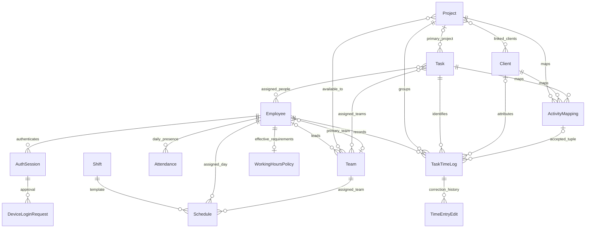

# CRM database schema

This reference describes the **current workspace code**, including the readiness changes. It was generated without loading `.env`, connecting to MongoDB, inspecting records, or reading credentials. Production may differ until deployment/index initialization. The database name comes from `MONGODB_URI`; its value is intentionally not read or included.

**Database:** MongoDB. **ODM:** Mongoose. **Models/collections:** 19. **Declared indexes:** 57, plus the normal `_id_` index on each ordinary collection. These are declarations, not verified live indexes.

## Collection map

| Collection | Mongoose model | Purpose |
| --- | --- | --- |
| `activity_link_changes` | `ActivityLinkChange` | Activity-link/unlink audit snapshots. |
| `activity_mappings` | `ActivityMapping` | Unique project/client/task activity tuples. |
| `attendances` | `Attendance` | Daily attendance derived from time entries, with retained historical check-in rows and productivity adjustments. |
| `authsessions` | `AuthSession` | Device authentication sessions and active desktop-session uniqueness. |
| `clients` | `Client` | Business clients; these are not authenticated user accounts. |
| `clientaccesschanges` | `ClientAccessChange` | Batch access-policy audit snapshots. |
| `clientaccesspolicies` | `ClientAccessPolicy` | Team/employee client limits and extra work-team/project grants. |
| `deviceloginrequests` | `DeviceLoginRequest` | Second-device approval requests and their cleanup lifecycle. |
| `employees` | `Employee` | Employee identities, authentication hashes, team membership, billing rates and individual permissions/idle policy. |
| `projects` | `Project` | Projects, client/team availability, linked tasks and activity-selection settings. |
| `role_permissions` | `RolePermission` | Saved permission sets for configurable roles. |
| `schedules` | `Schedule` | Employee/team/shift assignments by business day. |
| `shifts` | `Shift` | Shift templates, timezone, hours and embedded break definitions. |
| `systemsettings` | `SystemSettings` | Global idle policy and optional default activity configuration. |
| `tasks` | `Task` | Work/break tasks, team/employee assignment and soft deletion. |
| `task_time_logs` | `TaskTimeLog` | Live and completed timer sessions, pauses, totals, manual entries and retry identities. |
| `teams` | `Team` | Teams and their primary team lead. |
| `time_entry_edits` | `TimeEntryEdit` | Administrative correction revisions and before/after snapshots. |
| `workinghourspolicies` | `WorkingHoursPolicy` | Effective-dated per-employee working-hours requirements. |

## Main relationships

MongoDB ObjectId references are application-level links, not SQL foreign-key constraints. A `ref` enables Mongoose population; it does not prove a referenced record exists or provide cascading deletion. Several controllers separately validate assignment/activity access. The diagram shows the main logical relationships; detailed field tables below include every declared reference.



## How to read the field tables

- `[]` means an array; `revisions[].requiredSeconds` describes each embedded array element.
- Required applies when that path/subdocument is validated. A required array is not necessarily nonempty; a required child does not automatically make an optional parent mandatory.
- `unset` means there is no schema default. It does not mean null. Defaults do not imply that older stored records were backfilled.
- All root models enable timestamps: Mongoose manages `createdAt`/`updatedAt`. `_id` is normally generated; `__v` is the Mongoose version key, generally initially zero, not a universal optimistic concurrency lock.
- `hidden` means excluded by ordinary Mongoose selection (`select: false`), including children of hidden embedded fields. It is not encryption or a database access-control boundary.
- Empty primitive arrays normally default to `[]` unless explicitly suppressed. Embedded objects/arrays with `_id: false` do not get their own ObjectId; those with IDs have an `_id` row below.
- Tables cover schema-level constraints. Controllers/services enforce additional permissions, relationships, concurrency and business rules described later. `unique` is an index declaration, not a Mongoose validator.

## activity_link_changes (ActivityLinkChange)

Activity-link/unlink audit snapshots.

[Model source](../backend/src/models/ActivityLinkChange.js)

| Field | Type / reference | Required | Default | Constraints / selection |
| --- | --- | --- | --- | --- |
| `action` | String | Yes | `unset` | enum=["link","unlink"] |
| `mode` | String | Yes | `unset` | enum=["tasks","clients"] |
| `actor` | ObjectId → `Employee` | Yes | `unset` | — |
| `actorName` | String | Yes | `unset` | — |
| `projects` | Embedded[] | Yes | `[] (implicit)` | embedded _id=false |
| `projects[].id` | ObjectId | Yes | `unset` | — |
| `projects[].name` | String | Yes | `unset` | — |
| `clients` | Embedded[] | Yes | `[] (implicit)` | embedded _id=false |
| `clients[].id` | ObjectId | Yes | `unset` | — |
| `clients[].name` | String | Yes | `unset` | — |
| `tasks` | Embedded[] | No | `[]` | embedded _id=false |
| `tasks[].id` | ObjectId | Yes | `unset` | — |
| `tasks[].name` | String | Yes | `unset` | — |
| `combinationCount` | Number | Yes | `unset` | min=1 |
| `_id` | ObjectId | No | `generated ObjectId` | — |
| `createdAt` | Date | No | `unset` | immutable=true |
| `updatedAt` | Date | No | `unset` | — |
| `__v` | Number | No | `unset` | — |

**Declared indexes** (in addition to `_id_`):

- `{"mode":1,"createdAt":-1,"_id":-1}`; options `{}`
- `{"actor":1,"mode":1,"createdAt":-1,"_id":-1}`; options `{}`

## activity_mappings (ActivityMapping)

Unique project/client/task activity tuples.

[Model source](../backend/src/models/ActivityMapping.js)

| Field | Type / reference | Required | Default | Constraints / selection |
| --- | --- | --- | --- | --- |
| `project` | ObjectId → `Project` | Yes | `unset` | — |
| `client` | ObjectId → `Client` | Yes | `unset` | — |
| `task` | ObjectId → `Task` | Yes | `unset` | — |
| `isActive` | Boolean | No | `true` | — |
| `createdBy` | ObjectId → `Employee` | No | `unset (explicit)` | — |
| `updatedBy` | ObjectId → `Employee` | No | `unset (explicit)` | — |
| `migrationId` | String | No | `unset (explicit)` | immutable=true |
| `_id` | ObjectId | No | `generated ObjectId` | — |
| `createdAt` | Date | No | `unset` | immutable=true |
| `updatedAt` | Date | No | `unset` | — |
| `__v` | Number | No | `unset` | — |

**Declared indexes** (in addition to `_id_`):

- `{"project":1,"client":1,"task":1}`; options `{"unique":true,"name":"activity_tuple_unique"}`
- `{"project":1,"client":1,"isActive":1}`; options `{"name":"activity_picker"}`
- `{"task":1,"isActive":1}`; options `{"name":"activity_task"}`
- `{"updatedAt":1}`; options `{}`

## attendances (Attendance)

Daily attendance derived from time entries, with retained historical check-in rows and productivity adjustments.

[Model source](../backend/src/models/Attendance.js)

| Field | Type / reference | Required | Default | Constraints / selection |
| --- | --- | --- | --- | --- |
| `employee` | ObjectId → `Employee` | Yes | `unset` | — |
| `date` | String | Yes | `unset` | — |
| `checkIn` | Date | No | `null` | — |
| `checkOut` | Date | No | `null` | — |
| `totalHours` | Number | No | `0` | — |
| `status` | String | No | `"Present"` | enum=["Present","Absent"] |
| `source` | String | No | `"check_in"` | enum=["check_in","timer"] |
| `workingHoursAdjustments` | Embedded[] | No | `unset (explicit)` | embedded _id=false |
| `workingHoursAdjustments[].type` | String | Yes | `unset` | enum=["normal","half_day","leave","absent"] |
| `workingHoursAdjustments[].reason` | String | Yes | `unset` | maxlength=500 |
| `workingHoursAdjustments[].changedBy` | ObjectId → `Employee` | Yes | `unset` | — |
| `workingHoursAdjustments[].changedAt` | Date | Yes | `unset` | — |
| `_id` | ObjectId | No | `generated ObjectId` | — |
| `createdAt` | Date | No | `unset` | immutable=true |
| `updatedAt` | Date | No | `unset` | — |
| `__v` | Number | No | `unset` | — |

**Declared indexes** (in addition to `_id_`):

- `{"employee":1,"date":1}`; options `{"unique":true}`
- `{"employee":1,"updatedAt":1}`; options `{}`
- `{"updatedAt":1}`; options `{}`

## authsessions (AuthSession)

Device authentication sessions and active desktop-session uniqueness.

[Model source](../backend/src/models/AuthSession.js)

| Field | Type / reference | Required | Default | Constraints / selection |
| --- | --- | --- | --- | --- |
| `employee` | ObjectId → `Employee` | Yes | `unset` | — |
| `sessionId` | String | Yes | `unset` | unique=true |
| `deviceId` | String | Yes | `unset` | — |
| `deviceName` | String | Yes | `unset` | maxlength=160 |
| `clientType` | String | No | `"desktop"` | enum=["desktop","web"] |
| `status` | String | Yes | `"pending"` | enum=["pending","active","revoked","logged_out","expired","denied"] |
| `loginAt` | Date | No | `null` | — |
| `lastActivity` | Date | No | `Date.now()` | — |
| `expiresAt` | Date | Yes | `unset` | — |
| `revokedAt` | Date | No | `null` | — |
| `revokeReason` | String | No | `""` | — |
| `_id` | ObjectId | No | `generated ObjectId` | — |
| `createdAt` | Date | No | `unset` | immutable=true |
| `updatedAt` | Date | No | `unset` | — |
| `__v` | Number | No | `unset` | — |

**Declared indexes** (in addition to `_id_`):

- `{"employee":1}`; options `{}`
- `{"sessionId":1}`; options `{"unique":true}`
- `{"employee":1,"clientType":1,"status":1}`; options `{"name":"one_active_desktop_session_per_employee","unique":true,"partialFilterExpression":{"clientType":"desktop","status":"active"}}`
- `{"expiresAt":1}`; options `{"expireAfterSeconds":0}`

## clients (Client)

Business clients; these are not authenticated user accounts.

[Model source](../backend/src/models/Client.js)

| Field | Type / reference | Required | Default | Constraints / selection |
| --- | --- | --- | --- | --- |
| `clientName` | String | Yes | `unset` | trim=true |
| `company` | String | No | `""` | trim=true |
| `email` | String | No | `""` | trim=true; lowercase=true |
| `phone` | String | No | `""` | trim=true |
| `status` | String | No | `"Active"` | enum=["Active","Inactive"] |
| `createdBy` | ObjectId → `Employee` | Yes | `unset` | — |
| `_id` | ObjectId | No | `generated ObjectId` | — |
| `createdAt` | Date | No | `unset` | immutable=true |
| `updatedAt` | Date | No | `unset` | — |
| `__v` | Number | No | `unset` | — |

**Declared indexes** (in addition to `_id_`):

- `{"updatedAt":1}`; options `{}`

## clientaccesschanges (ClientAccessChange)

Batch access-policy audit snapshots.

[Model source](../backend/src/models/ClientAccessChange.js)

| Field | Type / reference | Required | Default | Constraints / selection |
| --- | --- | --- | --- | --- |
| `actor` | ObjectId → `Employee` | Yes | `unset` | — |
| `actorName` | String | Yes | `unset` | — |
| `team` | ObjectId | No | `null` | — |
| `teamName` | String | Yes | `unset` | — |
| `targets` | Embedded[] | Yes | `[] (implicit)` | embedded _id=false |
| `targets[].subjectType` | String | Yes | `unset` | enum=["team","employee"] |
| `targets[].subjectId` | ObjectId | Yes | `unset` | — |
| `targets[].name` | String | Yes | `unset` | — |
| `targets[].beforeEnabled` | Boolean | Yes | `unset` | — |
| `targets[].afterEnabled` | Boolean | Yes | `unset` | — |
| `targets[].beforeOverrideTeam` | Boolean | No | `false` | — |
| `targets[].afterOverrideTeam` | Boolean | No | `false` | — |
| `targets[].beforeWorkTeams` | Embedded[] | No | `[] (implicit)` | embedded _id=false |
| `targets[].beforeWorkTeams[].id` | ObjectId | No | `unset` | — |
| `targets[].beforeWorkTeams[].name` | String | No | `unset` | — |
| `targets[].afterWorkTeams` | Embedded[] | No | `[] (implicit)` | embedded _id=false |
| `targets[].afterWorkTeams[].id` | ObjectId | No | `unset` | — |
| `targets[].afterWorkTeams[].name` | String | No | `unset` | — |
| `targets[].beforeWorkProjects` | Embedded[] | No | `[] (implicit)` | embedded _id=false |
| `targets[].beforeWorkProjects[].id` | ObjectId | No | `unset` | — |
| `targets[].beforeWorkProjects[].name` | String | No | `unset` | — |
| `targets[].afterWorkProjects` | Embedded[] | No | `[] (implicit)` | embedded _id=false |
| `targets[].afterWorkProjects[].id` | ObjectId | No | `unset` | — |
| `targets[].afterWorkProjects[].name` | String | No | `unset` | — |
| `targets[].beforeClients` | Embedded[] | No | `[] (implicit)` | embedded _id=false |
| `targets[].beforeClients[].id` | ObjectId | No | `unset` | — |
| `targets[].beforeClients[].name` | String | No | `unset` | — |
| `targets[].afterClients` | Embedded[] | No | `[] (implicit)` | embedded _id=false |
| `targets[].afterClients[].id` | ObjectId | No | `unset` | — |
| `targets[].afterClients[].name` | String | No | `unset` | — |
| `targets[].version` | Number | Yes | `unset` | — |
| `_id` | ObjectId | No | `generated ObjectId` | — |
| `createdAt` | Date | No | `unset` | immutable=true |
| `updatedAt` | Date | No | `unset` | — |
| `__v` | Number | No | `unset` | — |

**Declared indexes** (in addition to `_id_`):

- `{"createdAt":-1,"_id":-1}`; options `{}`

## clientaccesspolicies (ClientAccessPolicy)

Team/employee client limits and extra work-team/project grants.

[Model source](../backend/src/models/ClientAccessPolicy.js)

| Field | Type / reference | Required | Default | Constraints / selection |
| --- | --- | --- | --- | --- |
| `subjectType` | String | Yes | `unset` | enum=["team","employee"] |
| `subjectId` | ObjectId | Yes | `unset` | — |
| `enabled` | Boolean | Yes | `unset` | — |
| `overrideTeam` | Boolean | No | `false` | — |
| `workTeams` | ObjectId[] → `Team` | No | `[] (implicit)` | — |
| `workProjects` | ObjectId[] → `Project` | No | `[] (implicit)` | — |
| `clients` | ObjectId[] → `Client` | No | `[] (implicit)` | — |
| `version` | Number | No | `0` | — |
| `updatedBy` | ObjectId → `Employee` | Yes | `unset` | — |
| `_id` | ObjectId | No | `generated ObjectId` | — |
| `createdAt` | Date | No | `unset` | immutable=true |
| `updatedAt` | Date | No | `unset` | — |
| `__v` | Number | No | `unset` | — |

**Declared indexes** (in addition to `_id_`):

- `{"subjectType":1,"subjectId":1}`; options `{"unique":true}`

## deviceloginrequests (DeviceLoginRequest)

Second-device approval requests and their cleanup lifecycle.

[Model source](../backend/src/models/DeviceLoginRequest.js)

| Field | Type / reference | Required | Default | Constraints / selection |
| --- | --- | --- | --- | --- |
| `requestId` | String | Yes | `unset` | unique=true |
| `requestTokenHash` | String | Yes | `unset` | hidden |
| `tokenVersion` | Number | No | `0` | — |
| `rememberedTokenHash` | String | No | `null` | hidden |
| `employee` | ObjectId → `Employee` | Yes | `unset` | — |
| `existingSession` | ObjectId → `AuthSession` | Yes | `unset` | — |
| `requestedSession` | ObjectId → `AuthSession` | Yes | `unset` | — |
| `deviceId` | String | Yes | `unset` | — |
| `deviceName` | String | Yes | `unset` | maxlength=160 |
| `clientType` | String | No | `"desktop"` | enum=["desktop","web"] |
| `status` | String | Yes | `"pending"` | enum=["pending","approving","approved","consumed","denied","expired","cancelled","superseded"] |
| `expiresAt` | Date | Yes | `unset` | — |
| `cleanupAt` | Date | Yes | `unset` | — |
| `resolvedAt` | Date | No | `null` | — |
| `_id` | ObjectId | No | `generated ObjectId` | — |
| `createdAt` | Date | No | `unset` | immutable=true |
| `updatedAt` | Date | No | `unset` | — |
| `__v` | Number | No | `unset` | — |

**Declared indexes** (in addition to `_id_`):

- `{"requestId":1}`; options `{"unique":true}`
- `{"employee":1}`; options `{}`
- `{"existingSession":1}`; options `{}`
- `{"status":1}`; options `{}`
- `{"expiresAt":1}`; options `{}`
- `{"cleanupAt":1}`; options `{"expireAfterSeconds":0}`
- `{"existingSession":1,"status":1,"createdAt":1}`; options `{}`

## employees (Employee)

Employee identities, authentication hashes, team membership, billing rates and individual permissions/idle policy.

[Model source](../backend/src/models/Employee.js)

| Field | Type / reference | Required | Default | Constraints / selection |
| --- | --- | --- | --- | --- |
| `employeeId` | String | Yes | `unset` | trim=true; uppercase=true; unique=true |
| `fullName` | String | Yes | `unset` | minlength=[2,"Full name must contain at least 2 characters"]; maxlength=[100,"Full name cannot exceed 100 characters"]; trim=true |
| `firstName` | String | No | `""` | trim=true |
| `lastName` | String | No | `""` | trim=true |
| `email` | String | Yes | `unset` | match=["/^[^\\s@]+@[^\\s@]+\\.[^\\s@]+$/","Please enter a valid email address"]; trim=true; lowercase=true; unique=true |
| `password` | String | Yes | `unset` | minlength=[8,"Password must contain at least 8 characters"]; hidden |
| `role` | String | No | `"employee"` | enum=["alpha","admin","team_lead","hr","manager","employee"] |
| `department` | String | No | `""` | trim=true |
| `designation` | String | No | `""` | trim=true |
| `companyName` | String | No | `""` | trim=true |
| `address1` | String | No | `""` | trim=true |
| `address2` | String | No | `""` | trim=true |
| `city` | String | No | `""` | trim=true |
| `state` | String | No | `""` | trim=true |
| `postalCode` | String | No | `""` | trim=true |
| `country` | String | No | `""` | trim=true |
| `phoneNumber` | String | No | `""` | trim=true |
| `serviceRates` | Embedded[] | No | `[]` | hidden; embedded _id=false; custom: A service type cannot be assigned more than once |
| `serviceRates[].serviceType` | String | Yes | `unset` | trim=true; enum=["FTC","Tax","Bookkeeping","Audit","Business Tax Return"]; hidden |
| `serviceRates[].chargeRate` | Number | Yes | `unset` | min=[0.01,"Charge rate must be greater than zero"]; max=[1000000,"Charge rate is too large"]; hidden |
| `projectRates` | Embedded[] | No | `[]` | embedded _id=false; custom: The same project cannot be assigned more than once |
| `projectRates[].project` | ObjectId → `Project` | Yes | `unset` | — |
| `projectRates[].chargeRate` | Number | Yes | `unset` | min=[0.01,"Charge rate must be greater than zero"]; max=[1000000,"Charge rate is too large"] |
| `isActive` | Boolean | No | `true` | — |
| `permissions` | String[] | No | `[]` | enum=["create_employees","edit_employees"] |
| `permissionOverrides.granted` | String[] | No | `unset (explicit)` | hidden |
| `permissionOverrides.revoked` | String[] | No | `unset (explicit)` | hidden |
| `permissionOverrides.updatedBy` | ObjectId → `Employee` | No | `null` | hidden |
| `permissionOverrides.updatedAt` | Date | No | `null` | hidden |
| `teamLead` | ObjectId → `Employee` | No | `null` | — |
| `team` | ObjectId → `Team` | No | `null` | — |
| `lastLoginAt` | Date | No | `null` | — |
| `tokenVersion` | Number | No | `0` | hidden |
| `rememberedSessionTokenHash` | String | No | `null` | hidden |
| `rememberedSessionExpires` | Date | No | `null` | hidden |
| `rememberedSessions` | Embedded[] | No | `[]` | hidden; embedded _id=true |
| `rememberedSessions[].tokenHash` | String | Yes | `unset` | hidden |
| `rememberedSessions[].expiresAt` | Date | Yes | `unset` | hidden |
| `rememberedSessions[]._id` | ObjectId | No | `generated ObjectId` | hidden |
| `idleTrackingExempt` | Boolean | No | `false` | hidden |
| `idlePolicyOverride.idleThresholdMinutes` | Number | No | `null` | hidden |
| `idlePolicyOverride.autoLogoutMinutes` | Number | No | `null` | hidden |
| `idlePolicyOverride.updatedBy` | ObjectId → `Employee` | No | `null` | hidden |
| `idlePolicyOverride.updatedAt` | Date | No | `null` | hidden |
| `passwordResetTokenHash` | String | No | `null` | hidden |
| `passwordResetExpires` | Date | No | `null` | hidden |
| `_id` | ObjectId | No | `generated ObjectId` | — |
| `createdAt` | Date | No | `unset` | immutable=true |
| `updatedAt` | Date | No | `unset` | — |
| `timeEntryEditVersion` | Number | No | `0` | — |
| `__v` | Number | No | `unset` | — |

**Declared indexes** (in addition to `_id_`):

- `{"employeeId":1}`; options `{"unique":true}`
- `{"email":1}`; options `{"unique":true}`
- `{"idleTrackingExempt":1}`; options `{"unique":true,"partialFilterExpression":{"idleTrackingExempt":true}}`
- `{"team":1}`; options `{}`
- `{"teamLead":1}`; options `{}`
- `{"role":1}`; options `{}`
- `{"updatedAt":1}`; options `{}`

## projects (Project)

Projects, client/team availability, linked tasks and activity-selection settings.

[Model source](../backend/src/models/Project.js)

| Field | Type / reference | Required | Default | Constraints / selection |
| --- | --- | --- | --- | --- |
| `projectCode` | String | Yes | `unset` | trim=true; unique=true |
| `projectName` | String | Yes | `unset` | trim=true |
| `serviceType` | String | No | `null` | trim=true; enum=["FTC","Tax","Bookkeeping","Audit","Business Tax Return",null] |
| `description` | String | No | `""` | — |
| `clientName` | String | No | `""` | — |
| `client` | ObjectId → `Client` | No | `null` | — |
| `clients` | ObjectId[] → `Client` | No | `[] (implicit)` | — |
| `activityLinksVersion` | Number | No | `0` | min=0 |
| `activityMappingEnabled` | Boolean | No | `false` | — |
| `linkedTasks` | ObjectId[] → `Task` | No | `[] (implicit)` | — |
| `teams` | ObjectId[] → `Team` | No | `[] (implicit)` | — |
| `status` | String | No | `"Active"` | enum=["Active","Completed","On Hold"] |
| `deletedAt` | Date | No | `null` | — |
| `startDate` | Date | No | `null` | — |
| `endDate` | Date | No | `null` | — |
| `createdBy` | ObjectId → `Employee` | Yes | `unset` | — |
| `_id` | ObjectId | No | `generated ObjectId` | — |
| `createdAt` | Date | No | `unset` | immutable=true |
| `updatedAt` | Date | No | `unset` | — |
| `__v` | Number | No | `unset` | — |

**Declared indexes** (in addition to `_id_`):

- `{"projectCode":1}`; options `{"unique":true}`
- `{"teams":1}`; options `{}`
- `{"client":1}`; options `{}`
- `{"updatedAt":1}`; options `{}`

## role_permissions (RolePermission)

Saved permission sets for configurable roles.

[Model source](../backend/src/models/RolePermission.js)

| Field | Type / reference | Required | Default | Constraints / selection |
| --- | --- | --- | --- | --- |
| `role` | String | Yes | `unset` | unique=true; enum=["hr","team_lead","employee"] |
| `permissions` | String[] | No | `[]` | — |
| `updatedBy` | ObjectId → `Employee` | No | `null` | — |
| `_id` | ObjectId | No | `generated ObjectId` | — |
| `createdAt` | Date | No | `unset` | immutable=true |
| `updatedAt` | Date | No | `unset` | — |
| `__v` | Number | No | `unset` | — |

**Declared indexes** (in addition to `_id_`):

- `{"role":1}`; options `{"unique":true}`

## schedules (Schedule)

Employee/team/shift assignments by business day.

[Model source](../backend/src/models/Schedule.js)

| Field | Type / reference | Required | Default | Constraints / selection |
| --- | --- | --- | --- | --- |
| `team` | ObjectId → `Team` | Yes | `unset` | — |
| `employee` | ObjectId → `Employee` | Yes | `unset` | — |
| `shift` | ObjectId → `Shift` | Yes | `unset` | — |
| `scheduleTitle` | String | No | `""` | trim=true |
| `date` | Date | Yes | `unset` | — |
| `scheduleDateKey` | String | No | `unset` | match="/^\\d{4}-\\d{2}-\\d{2}$/" |
| `notes` | String | No | `""` | trim=true |
| `status` | String | No | `"Active"` | enum=["Active","Inactive"] |
| `createdBy` | ObjectId → `Employee` | Yes | `unset` | — |
| `_id` | ObjectId | No | `generated ObjectId` | — |
| `createdAt` | Date | No | `unset` | immutable=true |
| `updatedAt` | Date | No | `unset` | — |
| `__v` | Number | No | `unset` | — |

**Declared indexes** (in addition to `_id_`):

- `{"employee":1,"date":1}`; options `{}`
- `{"employee":1,"scheduleDateKey":1}`; options `{"unique":true,"partialFilterExpression":{"status":"Active","scheduleDateKey":{"$type":"string"}}}`

## shifts (Shift)

Shift templates, timezone, hours and embedded break definitions.

[Model source](../backend/src/models/Shift.js)

| Field | Type / reference | Required | Default | Constraints / selection |
| --- | --- | --- | --- | --- |
| `title` | String | Yes | `unset` | trim=true |
| `timezone` | String | Yes | `unset` | — |
| `shiftType` | String | No | `"Fixed"` | enum=["Fixed","Flexible"] |
| `startTime` | String | Yes | `unset` | — |
| `endTime` | String | Yes | `unset` | — |
| `breakType` | String | No | `"Fixed"` | enum=["Fixed","Flexible"] |
| `breaks` | Embedded[] | No | `[]` | embedded _id=true |
| `breaks[].title` | String | Yes | `unset` | trim=true |
| `breaks[].startTime` | String | Yes | `unset` | — |
| `breaks[].endTime` | String | Yes | `unset` | — |
| `breaks[]._id` | ObjectId | No | `generated ObjectId` | — |
| `status` | String | No | `"Active"` | enum=["Active","Inactive"] |
| `createdBy` | ObjectId → `Employee` | Yes | `unset` | — |
| `_id` | ObjectId | No | `generated ObjectId` | — |
| `createdAt` | Date | No | `unset` | immutable=true |
| `updatedAt` | Date | No | `unset` | — |
| `__v` | Number | No | `unset` | — |

**Declared indexes** (in addition to `_id_`):

No additional indexes declared.

## systemsettings (SystemSettings)

Global idle policy and optional default activity configuration.

[Model source](../backend/src/models/SystemSettings.js)

| Field | Type / reference | Required | Default | Constraints / selection |
| --- | --- | --- | --- | --- |
| `key` | String | Yes | `"global"` | unique=true; enum=["global"] |
| `idleThresholdMinutes` | Number | No | `5` | min=1; max=240; custom: Validator failed for path `{PATH}` with value `{VALUE}` |
| `autoLogoutMinutes` | Number | No | `unset` | min=2; max=480; custom: Validator failed for path `{PATH}` with value `{VALUE}` |
| `defaultActivity` | Embedded | No | `unset (explicit)` | embedded _id=false |
| `defaultActivity.mapping` | ObjectId → `ActivityMapping` | Yes | `unset` | — |
| `defaultActivity.enabled` | Boolean | No | `false` | — |
| `defaultActivity.mode` | String | No | `"selection_only"` | enum=["selection_only"] |
| `_id` | ObjectId | No | `generated ObjectId` | — |
| `createdAt` | Date | No | `unset` | immutable=true |
| `updatedAt` | Date | No | `unset` | — |
| `__v` | Number | No | `unset` | — |

**Declared indexes** (in addition to `_id_`):

- `{"key":1}`; options `{"unique":true}`

## tasks (Task)

Work/break tasks, team/employee assignment and soft deletion.

[Model source](../backend/src/models/Task.js)

| Field | Type / reference | Required | Default | Constraints / selection |
| --- | --- | --- | --- | --- |
| `taskCode` | String | Yes | `unset` | trim=true; uppercase=true; unique=true |
| `taskName` | String | Yes | `unset` | trim=true |
| `description` | String | No | `""` | trim=true |
| `taskType` | String | No | `"work"` | enum=["work","break"] |
| `project` | ObjectId → `Project` | No | `null` | — |
| `team` | ObjectId → `Team` | No | `null` | — |
| `teams` | ObjectId[] → `Team` | No | `[] (implicit)` | — |
| `assignedTo` | ObjectId[] → `Employee` | No | `[] (implicit)` | — |
| `assignToAllEmployees` | Boolean | No | `false` | — |
| `isActive` | Boolean | No | `true` | — |
| `deletedAt` | Date | No | `null` | — |
| `idleLogout` | Boolean | No | `false` | — |
| `createdBy` | ObjectId → `Employee` | Yes | `unset` | — |
| `_id` | ObjectId | No | `generated ObjectId` | — |
| `createdAt` | Date | No | `unset` | immutable=true |
| `updatedAt` | Date | No | `unset` | — |
| `__v` | Number | No | `unset` | — |

**Declared indexes** (in addition to `_id_`):

- `{"taskCode":1}`; options `{"unique":true}`
- `{"team":1}`; options `{}`
- `{"teams":1}`; options `{}`
- `{"assignedTo":1}`; options `{}`
- `{"project":1}`; options `{}`
- `{"updatedAt":1}`; options `{}`

## task_time_logs (TaskTimeLog)

Live and completed timer sessions, pauses, totals, manual entries and retry identities.

[Model source](../backend/src/models/TaskTimeLog.js)

| Field | Type / reference | Required | Default | Constraints / selection |
| --- | --- | --- | --- | --- |
| `employee` | ObjectId → `Employee` | Yes | `unset` | — |
| `project` | ObjectId → `Project` | Yes | `unset` | — |
| `client` | ObjectId → `Client` | No | `null` | — |
| `activityMapping` | ObjectId → `ActivityMapping` | No | `unset (explicit)` | — |
| `task` | ObjectId → `Task` | Yes | `unset` | — |
| `startedAt` | Date | Yes | `unset` | — |
| `stoppedAt` | Date | No | `null` | — |
| `note` | String | No | `unset` | maxlength=2000; trim=true |
| `pauses` | Embedded[] | No | `[]` | embedded _id=false |
| `pauses[].pausedAt` | Date | Yes | `unset` | — |
| `pauses[].resumedAt` | Date | No | `null` | — |
| `pauses[].reason` | String | No | `"manual"` | enum=["manual","idle","break"] |
| `totalPausedSeconds` | Number | No | `0` | min=0 |
| `totalIdleSeconds` | Number | No | `0` | min=0 |
| `totalWorkedSeconds` | Number | No | `0` | min=0 |
| `status` | String | No | `"running"` | enum=["running","paused","stopped"] |
| `isActiveTimer` | Boolean | No | `true` | — |
| `desktopHeartbeatAt` | Date | No | `null` | — |
| `stopReason` | String | No | `null` | enum=["desktop_disconnected"] |
| `entrySource` | String | No | `"timer"` | enum=["timer","manual"] |
| `editVersion` | Number | No | `0` | min=0 |
| `manualEntry` | Embedded | No | `unset (explicit)` | embedded _id=false |
| `manualEntry.createdBy` | ObjectId → `Employee` | Yes | `unset` | — |
| `manualEntry.createdAt` | Date | Yes | `unset` | — |
| `manualEntry.reason` | String | Yes | `unset` | maxlength=500; trim=true |
| `manualEntry.deletedAt` | Date | No | `null` | — |
| `manualEntry.deletedBy` | ObjectId → `Employee` | No | `null` | — |
| `autoLogoutAt` | Date | No | `null` | — |
| `logoutReason` | String | No | `null` | enum=["manual","inactivity"] |
| `startOperationId` | String | No | `unset (explicit)` | — |
| `stopOperationId` | String | No | `unset (explicit)` | — |
| `manualOperationId` | String | No | `unset (explicit)` | — |
| `manualRequestHash` | String | No | `unset (explicit)` | — |
| `_id` | ObjectId | No | `generated ObjectId` | — |
| `createdAt` | Date | No | `unset` | immutable=true |
| `updatedAt` | Date | No | `unset` | — |
| `__v` | Number | No | `unset` | — |

**Declared indexes** (in addition to `_id_`):

- `{"employee":1,"isActiveTimer":1}`; options `{"unique":true,"partialFilterExpression":{"isActiveTimer":true}}`
- `{"employee":1,"startOperationId":1}`; options `{"unique":true,"partialFilterExpression":{"startOperationId":{"$type":"string"}}}`
- `{"employee":1,"stopOperationId":1}`; options `{"partialFilterExpression":{"stopOperationId":{"$type":"string"}}}`
- `{"employee":1,"status":1,"startedAt":1,"stoppedAt":1}`; options `{}`
- `{"employee":1,"manualEntry.createdBy":1,"manualOperationId":1}`; options `{"name":"manual_entry_operation","unique":true,"partialFilterExpression":{"manualOperationId":{"$type":"string"}}}`
- `{"isActiveTimer":1,"desktopHeartbeatAt":1}`; options `{}`
- `{"employee":1,"updatedAt":1}`; options `{}`
- `{"updatedAt":1}`; options `{}`
- `{"status":1}`; options `{}`

## teams (Team)

Teams and their primary team lead.

[Model source](../backend/src/models/Team.js)

| Field | Type / reference | Required | Default | Constraints / selection |
| --- | --- | --- | --- | --- |
| `teamName` | String | Yes | `unset` | trim=true; unique=true |
| `description` | String | No | `""` | trim=true |
| `teamLead` | ObjectId → `Employee` | No | `null` | — |
| `isActive` | Boolean | No | `true` | — |
| `createdBy` | ObjectId → `Employee` | Yes | `unset` | — |
| `_id` | ObjectId | No | `generated ObjectId` | — |
| `createdAt` | Date | No | `unset` | immutable=true |
| `updatedAt` | Date | No | `unset` | — |
| `__v` | Number | No | `unset` | — |

**Declared indexes** (in addition to `_id_`):

- `{"teamName":1}`; options `{"unique":true}`
- `{"updatedAt":1}`; options `{}`

## time_entry_edits (TimeEntryEdit)

Administrative correction revisions and before/after snapshots.

[Model source](../backend/src/models/TimeEntryEdit.js)

| Field | Type / reference | Required | Default | Constraints / selection |
| --- | --- | --- | --- | --- |
| `timeLog` | ObjectId → `TaskTimeLog` | Yes | `unset` | — |
| `employee` | ObjectId → `Employee` | Yes | `unset` | — |
| `revision` | Number | Yes | `unset` | — |
| `editedBy` | ObjectId → `Employee` | Yes | `unset` | — |
| `reason` | String | Yes | `unset` | maxlength=500 |
| `before` | Mixed | Yes | `unset` | — |
| `after` | Mixed | Yes | `unset` | — |
| `_id` | ObjectId | No | `generated ObjectId` | — |
| `createdAt` | Date | No | `unset` | immutable=true |
| `updatedAt` | Date | No | `unset` | — |
| `__v` | Number | No | `unset` | — |

**Declared indexes** (in addition to `_id_`):

- `{"timeLog":1,"revision":1}`; options `{"unique":true}`

## workinghourspolicies (WorkingHoursPolicy)

Effective-dated per-employee working-hours requirements.

[Model source](../backend/src/models/WorkingHoursPolicy.js)

| Field | Type / reference | Required | Default | Constraints / selection |
| --- | --- | --- | --- | --- |
| `employee` | ObjectId → `Employee` | Yes | `unset` | — |
| `version` | Number | No | `0` | — |
| `revisions` | Embedded[] | No | `[]` | embedded _id=false |
| `revisions[].effectiveFrom` | String | Yes | `unset` | — |
| `revisions[].requiredSeconds` | Number | Yes | `unset` | min=0; max=86400 |
| `revisions[].halfDayPercent` | Number | Yes | `unset` | min=1; max=100 |
| `revisions[].changedBy` | ObjectId → `Employee` | Yes | `unset` | — |
| `revisions[].changedAt` | Date | Yes | `unset` | — |
| `_id` | ObjectId | No | `generated ObjectId` | — |
| `createdAt` | Date | No | `unset` | immutable=true |
| `updatedAt` | Date | No | `unset` | — |
| `__v` | Number | No | `unset` | — |

**Declared indexes** (in addition to `_id_`):

- `{"employee":1}`; options `{"unique":true}`

## Polymorphic and snapshot fields

- `ClientAccessPolicy.subjectId` is interpreted as a Team or Employee according to `subjectType`; it has no static Mongoose `ref`. `workTeams`/`workProjects` grant work access separately from primary reporting membership.
- `ClientAccessChange.targets[]` snapshots IDs/names and before/after policy values. The `id` members of its client/team/project snapshot arrays are context-dependent, not independently enforced foreign keys. `team` is a context ID without a declared `ref`.
- `ActivityLinkChange.projects[]`, `clients[]` and `tasks[]` contain embedded `{ id, name }` audit snapshots; the IDs do not declare Mongoose `ref` constraints.
- `TimeEntryEdit.before` and `after` are required `Mixed` values. The schema does not constrain their internal keys. The correction service snapshots employee/project/client/task/mapping IDs, interval timestamps, pauses, note, time totals, entry source and status; inspect `backend/src/services/timeEntryEditing.js` for the current snapshot field list.

## Important application-level rules

- Employee passwords are bcrypt-hashed in a pre-save hook. Changing password or email invalidates password-reset hashes in pre-validation. Hash fields are sensitive; this reference contains no values from real records. Query updates must still follow the controller/service rules.
- Employee `serviceRates` and `projectRates` reject duplicate service/project assignments through custom validators. Service types are FTC, Tax, Bookkeeping, Audit and Business Tax Return. Current billing uses per-project rates and time logs; there is no dedicated invoice/billing collection among these models.
- Employee roles are alpha/admin/manager/hr/team_lead/employee. Admin-level authority is defined in the roles/permissions services. Saved role-permission documents cover only hr/team_lead/employee; missing documents use built-in defaults.
- Primary `Employee.team`/`teamLead` membership is synchronized by `teamAssignmentService`. Additional access-policy work teams/projects do not automatically grant management/report access.
- Project `client` and Task `team` retain primary legacy references alongside `clients[]`/`teams[]`. Project `linkedTasks[]` and `activity_mappings` allow reuse without moving historical task IDs. Project `activityMappingEnabled` controls strict tuple selection.
- Tasks/projects use `deletedAt` and status/active flags. Historical logs/mappings are retained; relationships can legitimately involve archived records.
- Every new live timer receives a server-generated heartbeat. Heartbeats are sent about every 20 seconds; the lease expires after 90 seconds, with a 30-second sweep. Null heartbeat remains valid in the schema for manual/historical records; it is not an opt-out for new API starts.
- Only one active timer per employee is enforced by a partial unique index. Start/manual operation indexes provide request identity. Manual entry/correction/live interval coordination additionally depends on the single-process per-employee write queue; indexes alone do not exclude overlapping stopped intervals.
- `TaskTimeLog.totalWorkedSeconds`, paused/idle totals and pause intervals are computed/validated by the timer/manual/correction services. Manual entries require an explanatory reason, authorization and non-overlap checks; not all of these requirements appear as schema validators.
- Attendance belongs to the business day on which the entry started. Its hours represent the first check-in to last checkout span, not net worked seconds. Legacy direct check-in/out writes are retired with HTTP 410; historical `source="check_in"` rows remain readable.
- `Schedule.scheduleDateKey` is derived in pre-validation from its Date using `APP_TIMEZONE` (fallback Asia/Kolkata). The active-only partial unique index prevents two active schedules per employee/business-day key.
- Working-hours requirements are versioned effective-date revisions; seconds range 0–86400, half-day percentage 1–100. Controller validation is stricter than the raw date-key strings in the model.
- SystemSettings is a singleton keyed `global`. Global idle-policy normalization/validation uses a five-minute idle fallback and fifty-minute logout fallback; logout must exceed idle. `autoLogoutMinutes` has no schema default even though the runtime fallback exists. Per-employee nullable overrides fall back to the global policy.
- AuthSession expiry and DeviceLoginRequest cleanup have TTL indexes. TTL cleanup is asynchronous; application expiry/status checks remain necessary. Device approval sessions/requests retain their own lifecycle status enums.
- Optimistic versions are separate fields: project `activityLinksVersion`, client-access/working-hours `version`, time-log `editVersion`, and employee `timeEntryEditVersion`. Do not substitute `__v` for these business protocols.

## Permission catalog

The full catalog and built-in role permission lists are included in `DATABASE_SCHEMA.json`. The string-array fields do not all have schema enums: permission services validate configurable keys when saving.

| Key | Label | Enforcement |
| --- | --- | --- |
| `view_tasks` | View tasks | none |
| `create_tasks` | Create tasks | backend |
| `edit_tasks` | Edit tasks | backend |
| `reassign_tasks` | Reassign tasks | backend |
| `complete_tasks` | Complete tasks | none |
| `archive_tasks` | Archive tasks | backend |
| `view_task_timesheets` | View task timesheets | none |
| `add_manual_entries` | Add manual timesheet entries | backend |
| `view_teams` | View teams | none |
| `create_teams` | Create teams | backend |
| `edit_teams` | Edit teams | backend |
| `assign_team_members` | Assign employees to teams | none |
| `remove_team_members` | Remove employees from teams | none |
| `assign_team_leads` | Assign team leads | backend |
| `view_team_timesheets` | View team timesheets | backend |
| `view_team_productivity` | View team productivity reports | none |
| `view_clients` | View clients | none |
| `manage_clients` | Create/edit clients | backend |
| `view_projects` | View projects | none |
| `manage_projects` | Create/edit projects | backend |
| `manage_activity_links` | Link projects, clients and tasks | backend |
| `assign_projects` | Assign projects | none |
| `view_personal_reports` | View personal reports | none |
| `view_team_reports` | View team reports | none |
| `view_all_reports` | View all employee reports | backend |
| `export_reports` | Export Excel/PDF | frontend |
| `view_billing_amounts` | View billing amounts | backend |
| `manage_service_rates` | Manage employee service rates | none |
| `view_financial_reports` | View financial reports | none |

## Index initialization and database-level limits

The application explicitly initializes session, activity-mapping/link-history, correction-audit, manual-operation, working-hours and client-access indexes during startup. Other schema indexes depend on the configured Mongoose/model initialization. The revision plugin adds an `updatedAt` index to selected catalog models; it is included above. Auto-create/index options are included in the JSON export.

Schema declarations are application validation, not a universal MongoDB JSON Schema validator. Raw collection writes can bypass Mongoose middleware/validators. This export does not establish the actual live index set, server validators, collection counts, orphan records, database/cluster name or backup status. Use an explicitly authorized read-only database inspection to compare a deployed environment.

## Regenerate

From the repository root:

```powershell
node docs/schema/export-schema.cjs
```

This regenerates `docs/DATABASE_SCHEMA.md` and `docs/DATABASE_SCHEMA.json` from the checked-out models. It requires the installed backend dependencies and does not connect to a database. The JSON includes every extracted field, nested field, declared index, validator message/custom validator expression, permission definition and schema option.
