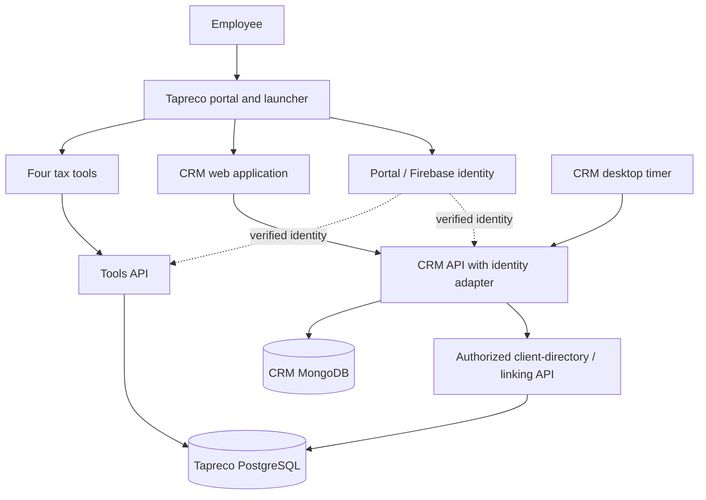

# Shared authentication, permissions and database architecture

Prepared: 13 November 2026  
Status: proposed design, based on the supplied Tapreco report and inspected CRM source.

## Target architecture

This is approach B from the overview. A shared user experience does not require every service to use the same database engine. Approach C later replaces MongoDB persistence with PostgreSQL through a tested migration.

## Sign-in flow

1. Add CRM to the portal's registered applications and allowed launch destinations.
2. Reuse the existing portal handoff implementation rather than introducing a second password screen.
3. CRM completes the handoff and obtains a Firebase browser session following the same contract as the four tools.
4. CRM API verifies the Firebase ID token and resolves its UID to a provisioned platform user.
5. Resolve the active firm and CRM entitlement through trusted server-side membership data.
6. Map the platform user and firm to a CRM Employee record; reject access when the mapping is absent, disabled or unauthorized.
7. Apply CRM permissions and device-session controls before serving CRM data.

Firebase's server verification API expects an **ID token**, not a portal handoff token or Firebase custom token. The existing token stages must stay distinct. See [Firebase ID-token verification](https://firebase.google.com/docs/auth/admin/verify-id-tokens).

For the first implementation, use a dedicated SSO exchange boundary that verifies platform identity and creates a CRM session. Continue using CRM session controls internally, while integrated users authenticate through Tapreco. This is an identity bridge, not a claim that CRM already accepts Firebase tokens. Existing `protect` middleware currently verifies CRM JWTs only.

## Session and account lifecycle

- Keep Firebase refresh credentials under the platform SDK's management. Never pass passwords between the applications.
- Check platform membership/entitlement and CRM account status on protected access with an explicit bounded revalidation policy; do not trust browser-supplied role or firm values.
- Define separate actions for “sign out of this application,” “sign out of Tapreco in this browser,” and “revoke all devices.”
- For integrated sessions, platform deactivation or firm removal must invalidate CRM access within a documented maximum delay. A long-lived CRM JWT must not bypass that check.
- Implement logout propagation across the participating web origins and CRM sessions. Do not assume browser sign-out alone revokes every server session.
- Distinguish CRM idle/timer policy from platform authentication expiry. Opening another tool must not silently alter recorded work.

Firebase documents refresh-token revocation and server-side revoked-session checks; these need deliberate integration with CRM session revocation. See [Firebase session management](https://firebase.google.com/docs/auth/admin/manage-sessions).

## Identity mapping and employee provisioning

Proposed identity-link fields:

| Field | Meaning |
| --- | --- |
| Identity issuer + Firebase UID | External authenticated identity |
| Platform user ID | Provisioned Tapreco user |
| Firm ID | Authorized business context |
| CRM employee ID | Existing operational employee record |
| CRM entitlement/status | Whether this person may use CRM in this firm |
| Mapping status and audit fields | Who approved the mapping, when and why |

Enforce uniqueness for the intended issuer/user/firm mapping. Existing Employee email is globally unique in CRM; supporting the same person in several firms needs an explicit membership model, not duplicate employee creation by email.

Email can suggest a migration candidate, but cannot authorize an automatic account merge. Require an administrator-reviewed mapping using verified identity. External-auth employees need an explicit authentication-provider model and conditional password requirements; the existing schema requires a password, so do not fill it with a shared placeholder.

## Authorization and firm isolation

Tapreco's supplied report describes owner-scoped tax records. CRM has team and company-level capabilities. Neither should automatically widen the other.

| User condition | Proposed result |
| --- | --- |
| Can use Estimated Tax, but has no CRM entitlement | CRM unavailable |
| CRM employee, ordinary tax-tool user | Own permitted CRM activity and own authorized tax work |
| CRM team lead | Team scope only where explicitly granted; no automatic access to team members' tax documents |
| Platform firm administrator | CRM administration only through an explicit CRM role mapping |
| CRM administrator | No automatic platform-wide or cross-firm authority |
| Linked client without permission to a workpaper | Client link may appear if allowed; workpaper content remains inaccessible |

Current inspected CRM core models do not establish a complete firm-isolation boundary. Before serving unrelated Tapreco firms, add firm ownership to all relevant records and enforce it in reads, writes, exports, jobs, caches and uniqueness constraints. Scope device/session lookups and operational locks consistently with the employee membership model. Missing firm scope must deny integrated access.

A single-firm pilot should be explicitly bound to the existing company database. It must not be presented as completed multi-firm support. Firm-scoped records also need owner/role checks within the firm; firm filtering alone is insufficient.

## Database choices

### Recommended first step: separate operational storage

PostgreSQL stores shared identity references, client directory and tool records. MongoDB retains CRM employees, teams, projects, tasks, attendance, timer intervals and billing history. Integrate through authenticated backend APIs and stable IDs. Do not expose either database directly to browser code.

### If one PostgreSQL database is mandatory

Create dedicated CRM tables/schema alongside the platform's supported tables. Reimplement Mongoose persistence, aggregations, atomic updates, indexes and migrations with PostgreSQL equivalents. Preserve old IDs through an explicit mapping, maintain timestamp precision and reconcile time, pauses, rates and billing totals.

Timer concurrency, device-session uniqueness, lease expiry and historical billing require particular care. Replacing `MONGODB_URI` with a PostgreSQL connection string cannot migrate this application.

Sharing a database does not authorize writing vendor-controlled tables. Use the platform's supported provisioning and membership interfaces.

## Desktop and repository impact

CRM web can adopt Tapreco's common shell. Retain Electron for system-wide mouse/keyboard inactivity monitoring; a browser tab does not provide the same operating-system idle capability. A desktop SSO integration needs its own secure browser handoff, one-time code exchange, device approval, logout and update testing. Avoid credentials in long-lived callback URLs.

An illustrative monorepo layout is `apps/crm-web`, `services/crm-api`, and `apps/crm-desktop`, alongside the existing tools. Exact folders are a proposal. Reuse common UI/auth packages where compatible and keep independent build/release jobs. CRM backend-only integration releases and desktop installer releases remain separate.

## Local evidence

- [CRM authentication middleware](../../backend/src/middleware/authMiddleware.js)
- [CRM auth routes](../../backend/src/modules/auth/authRoutes.js)
- [Employee schema](../../backend/src/models/Employee.js)
- [Device sessions](../../backend/src/models/AuthSession.js)
- [Production access rules](../../backend/src/services/production/access.js)
- [Desktop idle integration](../../desktop-app/main.js)
- [Current deployment configuration](../../render.yaml): one CRM instance is configured because several coordination mechanisms are in memory. Moving code to Tapreco does not remove this constraint.

