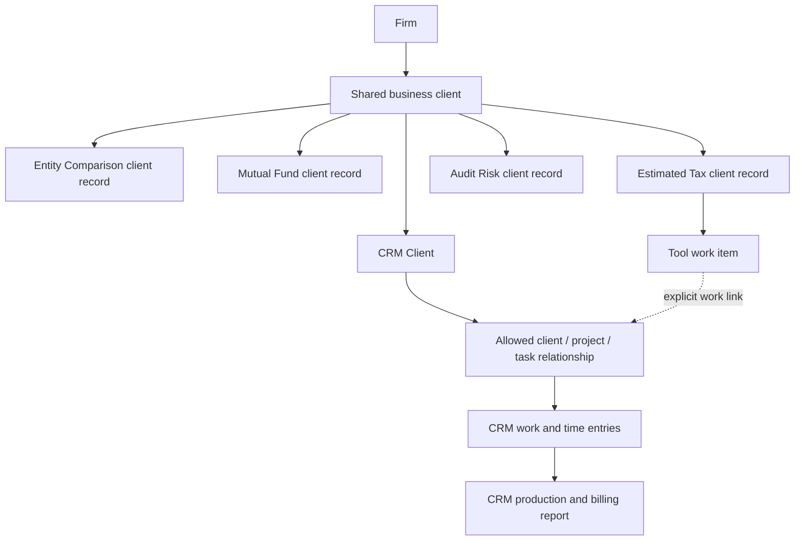

# Connecting Tapreco clients and work to CRM

Prepared: 13 November 2026  
Status: proposed data ownership and linking contract; no records have been merged or synchronized.

## Can clients created in the four tools be linked to CRM?

**Yes.** Give the business client a shared identifier, then link each tool's existing client record and the CRM Client record to it. Existing records can keep their original IDs and calculation history.

Do not automatically make a CRM project for every client. A client can have several projects and tax years; a project can also be a shared service, such as Audit, linked to several clients in the current CRM model.

## Separate these record types

| Record | Example | Responsible system |
| --- | --- | --- |
| Business client | Example Services LLC | Proposed shared client directory |
| Tool client record | Estimated Tax client ID 123 | Relevant tax tool |
| Tax work item | Estimated Tax 2026 workpaper | Relevant tax tool |
| CRM project | Estimated Tax service project | CRM |
| CRM task/activity | Prepare quarterly estimates | CRM |
| Time entry | Employee spends 45 minutes preparing estimates | CRM timer/manual-entry workflow |
| Billing result | Eligible recorded hours multiplied by the employee's project rate | CRM Production |

A tax estimate, workpaper amount or assessed risk is not a CRM billable amount. Taxpayer/client portal accounts are also distinct from internal CRM employee accounts.

## Proposed shared identifiers and relationships

### Proposed mapping records

| Record | Essential fields |
| --- | --- |
| Shared client | `firmId`, immutable `clientId`, display name, type, status, directory version |
| External client link | `firmId`, `clientId`, source tool/system, external client ID, visibility/owner context where needed, approval/audit fields |
| Tool-work link | `firmId`, tool, immutable work-item ID, shared client ID, CRM project ID, task ID, applicable activity-mapping ID |

The external link should be unique on firm + source system + external client ID. Several owner-specific tool client records may legitimately link to one shared client; sharing identity must not grant permission to read those owners' records.

Validate that the linked client, project, task and employee scope belong to the same authorized firm and permitted work relationship. External IDs are references, not authorization credentials.

## How users would work

### New client

1. User creates a client from an integrated tool or the shared client directory.
2. The directory creates the shared client once, with the user's firm and permissions.
3. The tool creates its own client record and stores the shared link.
4. An authorized CRM user chooses **Enable in CRM** and assigns the permitted team/project relationship.
5. CRM creates or links its local Client projection without copying tax returns or financial workpaper contents.

If directory synchronization is unavailable, keep a visible pending state and allow a safe retry. Do not claim a cross-database operation succeeded atomically when only one side saved.

### Existing client in multiple tools

1. Produce a comparison list of tool client IDs, permitted owner context and existing CRM clients.
2. Suggest possible matches using minimal identifying data.
3. Administrator reviews ambiguous names, similarly named companies and duplicate candidates.
4. Save approved mappings without changing historical IDs.
5. Leave uncertain cases unlinked until resolved. Do not merge by name or email alone.

### Tool work becomes CRM work

From a workpaper or assessment, an authorized employee chooses **Link CRM work**. They choose an existing project/task or create one if permitted. Subsequent visits use that saved link.

Opening or editing a tax work item does not automatically start a billable timer. Use an explicit **Track time** action through the supported desktop integration. CRM remains responsible for running-timer uniqueness, idle detection and stopping work.

The tool can display a permitted time summary through an API; it should not independently calculate a second set of billable hours.

## Suggested service projects

These are examples, not automatic production setup changes.

| Tool | Possible CRM service project | Example task |
| --- | --- | --- |
| Mutual Fund | Investment tax support | Review state-exempt income allocation |
| Estimated Tax | Estimated tax services | Prepare quarterly payment workpaper |
| Entity Comparison | Entity advisory | Prepare Schedule C / S-Corp comparison |
| Audit Risk | Return review | Review assessment findings |

Keep existing WCPA Audit/FTC projects where suitable. Add links instead of duplicating projects simply to match tool names. Employee/project rates continue to come from the CRM employee rate configuration. Team billing enablement and activity classifications still determine what contributes to billing; a tool link alone does not make work billable.

## Ownership and synchronization rules

| Data | Who changes it? | What synchronizes? |
| --- | --- | --- |
| Common client name/status | Authorized shared-directory workflow | Minimal CRM/tool display projections |
| Tool scenarios, tax inputs, assessments | Relevant tool under its existing access rules | Reference and authorized summary only |
| CRM team/project/task assignments | CRM | Permitted references/status back to tools |
| Employee project rates, attendance, breaks and idle | CRM | Only explicitly authorized summaries |
| Tax work deletion | Relevant tool | Link becomes unavailable/archived; time and billing history retained |
| Shared client archive | Shared directory | Stops new work where policy requires; preserves historical records |

Avoid uncontrolled two-way edits. During migration, existing CRM-only clients can remain local until reviewed and linked. New integrated shared clients should use the directory as the authority for common fields.

## Reliable integration without excessive traffic

- Use backend-to-backend authenticated events or APIs with explicit firm scope and service permissions.
- Publish changes through a transactional outbox in the source system, where supported, or an equivalent durable delivery mechanism. A plain webhook call after a save is not a reliable queue.
- Deduplicate by event ID; enforce unique mappings and idempotent create/link requests.
- Apply version checks so a delayed rename cannot overwrite a newer one.
- Retry failures with backoff and expose unresolved links for review; reconcile periodically with incremental cursors.
- Send only necessary changed fields. Do not make every timer heartbeat query all four tax tools.
- Record mapping changes and actors without logging authentication tokens or tax documents.

All API and event shapes above are proposals, not existing endpoints.

## Local CRM evidence

- [Client fields](../../backend/src/models/Client.js)
- [Project/client/team relationships](../../backend/src/models/Project.js)
- [Exact activity tuple](../../backend/src/models/ActivityMapping.js)
- [Time entry references and intervals](../../backend/src/models/TaskTimeLog.js)
- [Employee project rates](../../backend/src/models/Employee.js)

