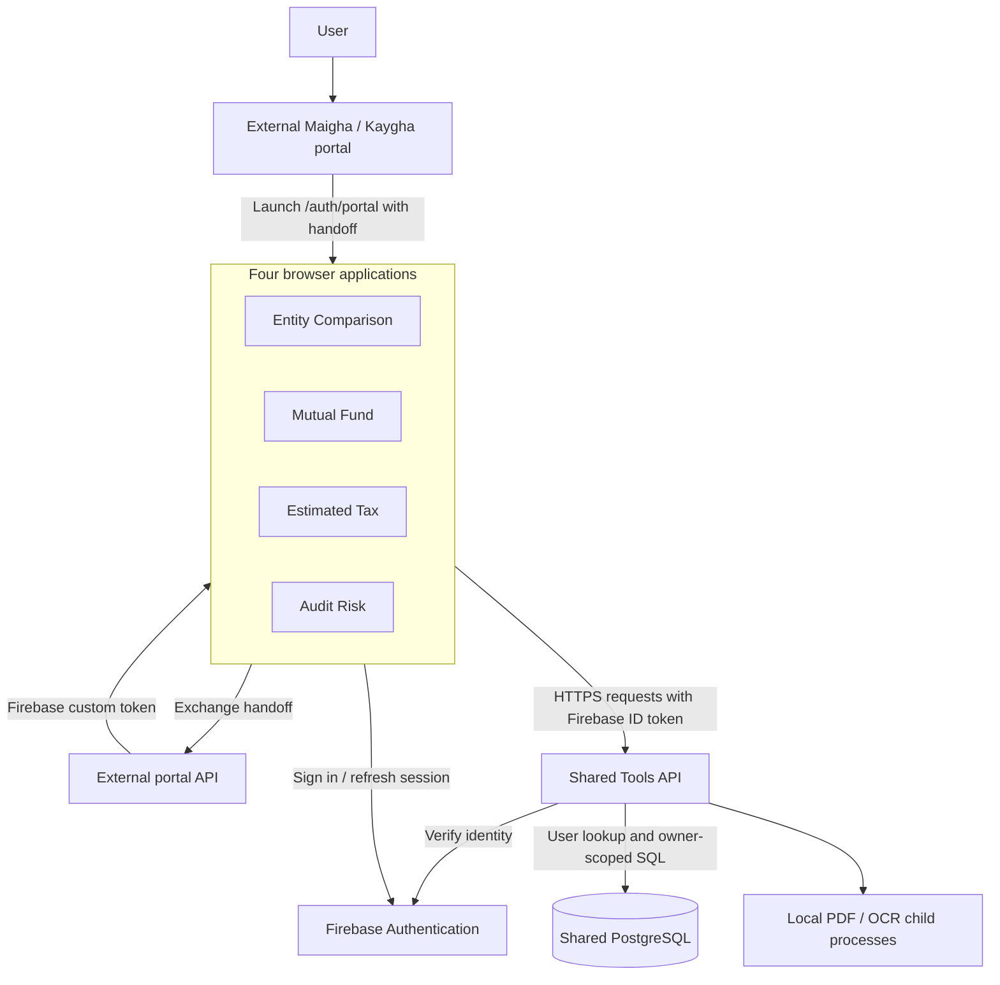

# Tapreco: code structure, architecture and hosting

Reviewed against this repository on **13 November 2026**.

This guide explains the current code layout, how the applications communicate, where data is stored, and what the repository establishes about hosting. It is a source-based overview: live cloud accounts, deployment logs, public URLs and database contents were not inspected. No application configuration or infrastructure was changed to prepare this document.

## 1. System overview

Tapreco is a multi-application repository containing **four React web applications, one shared Tools API, and an older Entity Comparison API**. The four current tools use the shared API. The external Maigha/Kaygha portal owns login and user provisioning; its source is outside this repository.

| Component | Technology | Main responsibility |
| --- | --- | --- |
| Entity Comparison | React 19, TypeScript, Vite | Entity tax comparisons, clients, worksheets, charts and reports |
| Mutual Fund | React 19, TypeScript, Vite | Fund/state allocation calculations, client scenarios and exports |
| Estimated Tax | React 19, TypeScript, Vite | Estimated-tax workpapers, annual summaries and history |
| Audit Risk | React 19, TypeScript, Vite | Return upload/manual entry, review, assessment and reports |
| Shared Tools API | Node.js 24, Express 5, CommonJS JavaScript | Authentication, ownership checks, SQL persistence, calculations and PDF/OCR processing |
| Shared database | PostgreSQL through `pg` | Tool records and externally managed Maigha identity records |
| External identity provider | Firebase Authentication, project `maigha-taxpro` | Browser sessions and server token verification |
| Older Entity API | Express and TypeScript | Retained development/demo integration path |

Each app/service has its own `package.json` and lockfile. There are no npm workspaces. The root package coordinates selected commands with `concurrently`.

## 2. Repository structure

```text
tapreco/
|-- apps/
|   |-- entity-comparison-web/
|   |   |-- src/                 UI, session, clients, calculator and report code
|   |   |   |-- engine/          Calculation modules and tables
|   |   |   |-- worksheet/       Worksheet state, rows and alerts
|   |   |   |-- report/          Report formatting and exports
|   |   |   `-- api/             API client code
|   |   |-- public/              Static browser assets
|   |   `-- tests/               Unit and Playwright tests
|   |-- mutual-fund-web/
|   |   |-- src/                 Workspace, engines, catalogs, saving and reports
|   |   |-- data/                Prepared/staged reference data and preparation tools
|   |   `-- tests/               Calculation, session, UI and export tests
|   |-- estimated-tax-web/
|   |   |-- src/
|   |   |   `-- workpapers/      Workpaper UI, engine, storage, history and summaries
|   |   |-- docs/                Supporting reference material
|   |   `-- tests/               Workpaper, session and browser tests
|   |-- audit-risk-web/
|   |   |-- src/                 Upload, manual entry, review, results and drafts
|   |   `-- tests/               Startup, session, storage and browser tests
|   `-- shared/
|       |-- auth/                App switching and origin logout helpers
|       |-- theme/               Shared CSS tokens, components and fonts
|       `-- openingWorkspace*   Shared loading-screen support
|-- services/
|   |-- tools-api/
|   |   |-- src/
|   |   |   |-- server.js        Startup, database checks and graceful shutdown
|   |   |   |-- app.js           Express setup, CORS and route mounting
|   |   |   |-- firebase.js      Firebase Admin initialization/token verification
|   |   |   |-- middleware/     Authentication and provisioned-user context
|   |   |   |-- db/             PostgreSQL pool, TLS and connection configuration
|   |   |   |-- routes/         Tool HTTP endpoints and SQL operations
|   |   |   |-- auditRiskRules/ Deterministic assessment rules
|   |   |   `-- *.js            Domain validation, processing and report modules
|   |   |-- migrations/         Numbered SQL migrations 001 through 015
|   |   |-- scripts/            Database checks, migrations and catalog utilities
|   |   |-- tests/              API, ownership, calculation and processing tests
|   |   `-- Dockerfile          Node 24 container definition
|   `-- entity-comparison-api/  Older API with its own source and tests
|-- scripts/                    Setup, build cleanup, release and review utilities
|-- docs/
|   |-- architecture/           Earlier architecture reports and audits
|   |-- integration/            Portal contracts and historical hosting plans
|   `-- refactor/               Implementation and verification records
|-- package.json                Root command orchestration
`-- README.md                   Local setup plus older Phase 1 material
```

Every frontend also has `vite.config.ts`, `wrangler.toml`, TypeScript configuration and its package files. Build output is generated in that app's `dist/` directory.

## 3. Application architecture and request flow



The frontends render the workspace and manage interactions. Domain modules contain calculation and formatting logic. API clients send authenticated requests to `services/tools-api`, whose route handlers validate requests and execute parameterized SQL. There is no ORM in this service.

### Login and authorization

1. The external portal launches a tool through `/auth/portal` with a handoff token in the URL fragment.
2. The tool's `portalHandoff.ts` handles the handoff, removes sensitive fragment data and restricts return navigation.
3. The browser exchanges the handoff through the external `/v1/auth/portal-token` endpoint and signs in using a Firebase custom token when exchange is required.
4. The Firebase SDK maintains the browser session. API calls obtain a current Firebase ID token.
5. Tools API verifies the bearer token using Firebase Admin, including revocation/disabled-account checking. Recent successful read checks can be cached briefly.
6. `middleware/context.js` resolves the verified UID to a live `public."User"` record. Missing provisioning returns `403 user_not_provisioned`.
7. Tool queries scope records to the resolved user's `owner_user_id`. Firm membership is used for profile context; it does not automatically grant access to another owner's tool records.

The portal handoff token, Firebase custom token and Firebase ID token serve different steps. Tools API authenticates requests with the **ID token**. Tools API does not create its own independent login platform or automatically provision Maigha users.

### Where calculations and reports run

| Tool | Main code areas | Processing boundary |
| --- | --- | --- |
| Entity Comparison | `entityTax.ts`, `engine/`, `worksheet/`, `report/` | Browser calculations/report exports; shared API persists clients and worksheets |
| Mutual Fund | `*Engine.ts`, `fundCatalog.ts`, `planningApi.ts`, `fundReport*.ts` | Browser calculations plus server calculation/catalog validation and saved revisions |
| Estimated Tax | `src/workpapers/engine.ts`, `rules.ts`, `storage.ts`, `history.ts` | Browser workpaper engine; shared API stores workpapers and audit/history records |
| Audit Risk | Frontend import/review modules; API `auditRisk*.js` and `auditRiskRules/` | Server extraction, local OCR, assessment and report processing, with browser review |

Mutual Fund has an important deployment dependency: the API loads TypeScript engines and reference data from `apps/mutual-fund-web`. Its backend artifact therefore needs those files as well as the API source.

Audit Risk uses local PDF/OCR worker processes. Temporary jobs are held in process memory, while saved drafts and revisions use PostgreSQL. Restarting the API can discard unsaved jobs; saved database records have a separate lifetime. The reviewed processing path uses deterministic rules and local OCR.

## 4. API and database structure

The shared API mounts these route families in [`app.js`](services/tools-api/src/app.js):

| Route | Purpose |
| --- | --- |
| `/health`, `/api/health` | Public process liveness |
| `/ready`, `/api/ready` | Public database/schema readiness status |
| `/api/tools` | Public catalog; per-tool status requires authentication/context |
| `/api/me`, `/api/context` | Verified, provisioned user identity/context |
| `/api/entity-comparison` | Entity clients and worksheet persistence |
| `/api/mutual-fund` | Older allocation session endpoints |
| `/api/mutual-fund/planning` | Catalog, calculation, clients, scenarios and revisions |
| `/api/estimated-tax` | Estimated-tax clients, saved work and history |
| `/api/audit-risk` | Imports, manual returns, review, drafts, assessments and reports |
| `/api/dev/login` | Conditional local-development login helper |

The database is shared with the external Maigha application. The current API README identifies a **Supabase-hosted PostgreSQL** setup; older hosting reports describe **Neon**. The actual runtime target is selected by the private `DATABASE_URL`, so those historical references do not prove which database a running deployment uses.

| Data area | Principal tables or records |
| --- | --- |
| External identity | `"User"`, `"Firm"`, `"FirmMember"` |
| Entity Comparison | `entity_comparison_clients`, `entity_comparison_worksheets` |
| Estimated Tax | Clients, scenarios, revisions and `estimated_tax_workpaper_audit` |
| Mutual Fund | Clients, scenarios, revisions, published catalogs, funds, allocations and sources; older sessions |
| Audit Risk | Clients, assessments, revisions and drafts |
| Migration bookkeeping | `tools_schema_migrations`, including checksums |

Migrations 001-008 introduce the original tools schema and ownership/deletion features. Migration 009 renames the earlier user table; 010 adopts Maigha's `"User"`; 011 restricts Supabase API-role access; 012 adds Entity Comparison storage; 013-015 extend Estimated Tax workpapers, history, 2027 support and client deletion.

Migration files are in [`services/tools-api/migrations`](services/tools-api/migrations). Startup checks connectivity and selected schema requirements but does **not** apply migrations. The migration runner performs pre-check, ordered migration and post-check; applied migrations must retain their recorded checksums. See the [migration guide](services/tools-api/scripts/database/README.md).

## 5. Hosting: what is established by the repository

The checked-in files support the following description. They do not establish a verified inventory of live cloud resources.

| Layer | Repository evidence | What can be concluded |
| --- | --- | --- |
| Four frontend sites | A `wrangler.toml` in each app | Each app is configured for Cloudflare Workers static-assets hosting of `dist/` |
| Frontend navigation | `not_found_handling = "single-page-application"` | The configured asset host falls back to the SPA for direct navigation such as `/auth/portal` |
| Shared API | Node start script and Dockerfile | The backend can run as a Node process/container; its current production provider is unconfirmed |
| Earlier API/site plan | Render hosting report dated 12 October 2026 | Render was documented as a deployment option; the report is not evidence that those services were created |
| Database | Current API README and SQL migrations | Shared PostgreSQL integration with Supabase-specific restrictions; runtime target is environment-controlled |
| Portal | Handoff modules and integration records | Login/launch and token exchange depend on separately hosted external services |
| Deployment automation | No checked-in GitHub Actions workflow or whole-system deployment manifest found | Cloud dashboard configuration or external CI may exist outside this checkout |

### Cloudflare frontend configuration

| Frontend | Wrangler service name | Published asset directory |
| --- | --- | --- |
| Entity Comparison | `entitycomparison-ui` | `./dist` |
| Mutual Fund | `mutualfund-ui` | `./dist` |
| Estimated Tax | `estimatedtax-ui` | `./dist` |
| Audit Risk | `auditriskanalyzer-ui` | `./dist` |

The names above are configured service names, not verified public URLs. The files do not identify an account subdomain or deployed custom domain.

The frontend artifact is produced by `npm run build` in each app, which runs `tsc -b && vite build`. Cloudflare serves the resulting HTML, JavaScript, CSS, fonts and other static assets. The browser then calls the separately hosted Tools API. The Wrangler files do not deploy the Express service.

Builds must retain access to `apps/shared`, which is imported by frontend code/configuration. Publishing only the completed `dist/` is appropriate for the asset host; building from a checkout that omits shared source is insufficient.

### Backend hosting configuration

`services/tools-api/package.json` requires **Node >=24 and <25**. `npm start` runs `node src/server.js`; the server uses the platform's `PORT`, falling back to `4000`. It verifies Firebase configuration, database connectivity and required schema state before listening. Shutdown drains requests and closes the PostgreSQL pool.

The Dockerfile uses `node:24-bookworm-slim`, installs fonts for document processing, runs as the `node` user and probes `/ready`. It copies API source, scripts and migrations. **It does not currently copy the Mutual Fund frontend engines/data required by the API.** The existing Dockerfile therefore does not establish a complete four-tool backend artifact without addressing that packaging dependency.

The [older Render report](docs/integration/RENDER_FOUR_TOOLS_HOSTING_REPORT.md) describes four static sites and one shared Node Web Service. Its suggested service names/URLs and Neon instructions are historical planning material. The current Cloudflare configuration and shared-user database model should be considered when using it.

### Environment configuration

| Variable group | Used by | Purpose |
| --- | --- | --- |
| `VITE_TOOLS_API_URL` | Frontend build | Public Tools API origin |
| `VITE_PORTAL_URL` | Frontend build | Portal login/launch origin |
| `VITE_APP_API_URL` | Frontend build | External portal token-exchange API origin |
| `VITE_APP_FIREBASE_*` | Frontend build | Firebase web configuration |
| `VITE_DEV_AUTO_LOGIN` | Frontend development | Development helper flag; disable for public deployment |
| `NODE_ENV`, `PORT` | API runtime | Runtime mode and listener port |
| `DATABASE_URL`, `DATABASE_*` | API runtime | Private PostgreSQL connection, TLS and pool settings |
| `FIREBASE_PROJECT_ID`, `FIREBASE_CLIENT_EMAIL`, `FIREBASE_PRIVATE_KEY` | API runtime | Firebase Admin verification and credentials |
| `CORS_ORIGINS` | API runtime | Explicit browser origins permitted to call the API |
| `DEV_AUTO_LOGIN_ENABLED`, `DEV_AUTO_LOGIN_KEY`, `DEV_FIREBASE_UID` | API development | Guarded development sign-in configuration |

`VITE_*` values are compiled into browser assets; changes require rebuilding the affected app. Database passwords and Firebase Admin private keys belong only in backend configuration. The API explicitly loads `services/tools-api/.env`; platform-provided environment values take precedence.

Production API configuration requires explicit HTTPS CORS origins and disables insecure development database TLS overrides. The current verifier checks revocation, so its runtime needs appropriate Firebase Admin credentials/permissions, rather than assuming a project ID alone is sufficient for all authentication operations.

## 6. Local setup and build commands

Use Node.js **24.x** for the shared API. From the repository root:

```powershell
npm run setup:tools
npm run dev:tools:all
```

Configure app/API environment files from their examples first. Portal login also needs the external portal and token-exchange API. Starting these tools does not start the external Maigha/Kaygha system.

| Process | Configured development URL |
| --- | --- |
| Entity Comparison | `http://localhost:5173` |
| Mutual Fund | `http://localhost:5175` |
| Estimated Tax | `http://localhost:5176` |
| Audit Risk | `http://localhost:5177` |
| Shared Tools API | `http://localhost:4000` unless `PORT` overrides it |
| Older Entity API | `http://localhost:3001` in its original setup |

The four current Vite configurations use fixed ports (`strictPort: true`) and bind to `0.0.0.0`. They proxy `/api` to the local shared API. Those development proxy settings do not supply production routing.

Build each current frontend explicitly:

```powershell
npm --prefix apps/entity-comparison-web run build
npm --prefix apps/mutual-fund-web run build
npm --prefix apps/estimated-tax-web run build
npm --prefix apps/audit-risk-web run build
```

For database diagnostics, `npm --prefix services/tools-api run db:check` checks connection/authentication without SQL; `db:precheck` and `db:postcheck` inspect migration/table state. `db:migrate` applies pending changes and should be run against the intended database as a deliberate release operation.

**Root command distinction:** `npm run build` builds only Entity Comparison. `npm run dev`, `build:server` and `start:server` retain the older Entity API path. Use `dev:tools:all` or `start:tools-api` for the shared backend architecture. Root `lint` and `test:api` also do not cover every current tool.

## 7. What remains to confirm about the live deployment

To turn this source-based guide into an exact record of the currently hosted system, record:

- The actual four frontend URLs and their Cloudflare account/project mappings.
- The shared API URL, hosting provider, resource/service name and deployed Git commit.
- The runtime database provider/project, without including credentials.
- The public portal and exchange API origins, allowed tool origins and Firebase authorized domains.
- Where deployments are triggered and where runtime secrets are managed.
- Monitoring, backups, recovery procedures and whether Audit jobs use a single API instance.

Hosting verification should cover portal launch, refresh, provisioned-user access, owner isolation, saved-work reload, Mutual Fund server engine/data availability and Audit PDF/OCR/report processing. A visible frontend or successful `/health` response alone does not verify those dependencies.

## 8. Source references and documentation differences

- [Root scripts](package.json)
- [Shared API source](services/tools-api/src/app.js), [startup](services/tools-api/src/server.js) and [README](services/tools-api/README.md)
- [Firebase verification](services/tools-api/src/firebase.js) and [user context](services/tools-api/src/middleware/context.js)
- [Backend Dockerfile](services/tools-api/Dockerfile)
- Cloudflare configuration: [Entity](apps/entity-comparison-web/wrangler.toml), [Mutual Fund](apps/mutual-fund-web/wrangler.toml), [Estimated Tax](apps/estimated-tax-web/wrangler.toml), [Audit Risk](apps/audit-risk-web/wrangler.toml)
- [Shared frontend source](apps/shared)
- [Database migration guide](services/tools-api/scripts/database/README.md)
- [Earlier architecture audit](docs/architecture/CURRENT_ARCHITECTURE_AND_CODE_AUDIT_2026-10-19.md)
- [Historical Render hosting plan](docs/integration/RENDER_FOUR_TOOLS_HOSTING_REPORT.md)

The root README combines current local setup with older Phase 1 descriptions such as “Entity Comparison only” and “no database.” The October architecture reports also predate Entity Comparison persistence and later Estimated Tax migrations. This guide describes the current inspected files; historical plans and old audit findings should be checked against current source before being treated as current behavior.
